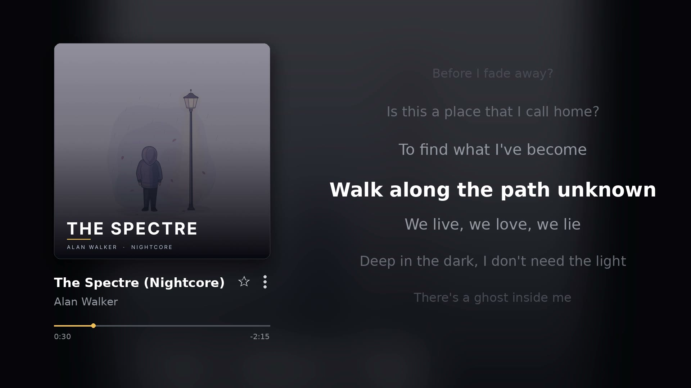
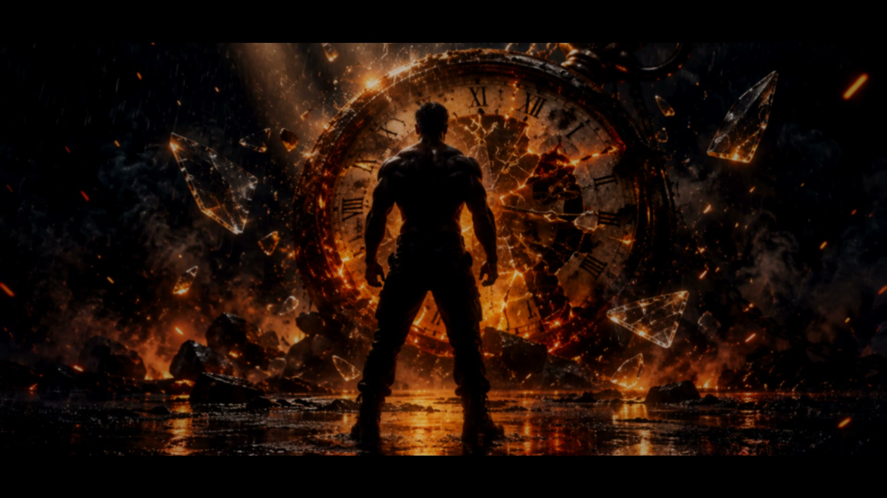

# lyric-video-skill

An agent skill + toolkit that turns **a song + cover art + timed lyrics** into a finished
lyric video. Two production looks, one command each. Pure Python (Pillow) + ffmpeg.

| Spotify "now playing" style | Cinematic motivational style |
|---|---|
|  |  |

---

## Why this exists

Making a lyric video by hand means fighting three separate problems: syncing text to audio,
keeping the motion smooth, and making the frame look designed rather than thrown together.
This kit solves all three and keeps the decisions in one place — a spec you can hand to any
agent (or run yourself).

## Quick start

```bash
git clone https://github.com/CyberGaurav404/lyric-video-skill
cd lyric-video-skill
pip install pillow imageio-ffmpeg     # ffmpeg binary comes with imageio-ffmpeg

# Spotify style
python scripts/spotify_lyrics.py \
    --audio song.mp3 --srt lyrics.srt --cover cover.png \
    --title "Song (Nightcore)" --artist "Artist" --out lyric_video.mp4

# Cinematic motivational style
SRC=song.mp3 SRT=lyrics.srt BG_IMG=bg_baked.png TOTAL=215.6 \
    python scripts/motivational_render.py 0 45 part1.mp4
```

Full instructions: **[docs/GUIDE.md](docs/GUIDE.md)** (setup, both styles, chunked rendering,
QA checklist, troubleshooting) and **[briefs/Lyric_Video_Brief.md](briefs/Lyric_Video_Brief.md)**
(design spec + self-contained renderer).

## What's inside

```
SKILL.md                     agent-facing skill definition
README.md                    setup, commands, QA, troubleshooting
PROMPTS.md                   copy-paste prompts for new chats
briefs/Lyric_Video_Brief.md  full design spec + self-contained renderer
scripts/
  spotify_lyrics.py          Spotify "now playing" renderer (CLI)
  motivational_render.py     cinematic renderer (Kalam font, word highlight)
  cover_art.py               procedural album cover
  gen_bg2.py                 procedural cinematic background
  bake_bg.py                 bloom + teal-orange grade + vignette
assets/                      sample cover, sample plate, Kalam font
examples/                    sample SRTs (English + Hindi)
docs/                        preview frames
```

## Design tokens (Spotify style)

| Element | Value |
|---|---|
| Canvas | 1920×1080, 30 fps, h264 CRF 19, AAC 192k |
| Background | cover 1.25×, 58 px blur, 66% dark overlay |
| Album card | 600×600 at (150,120), radius 18, shadow blur 22 |
| Title / artist | bold 40 px white / 30 px `#9698A4` |
| Progress | track `#50525C` 4 px, fill `#F0C05A`, knob 12 px |
| Lyrics | column x=1370, active line y=520 |
| Type scale | active 54 px bold, ±1 42, ±2 38, ±3 34; spacing 104 px |
| Scroll | `scroll = (i-1) + smoothstep((t - lineStart + 0.30)/0.60)` |

## Cinematic style

Full-bleed background, 2.35:1 letterbox, bloom/halation, teal-orange grade, vignette,
slow continuous push-in (1.00 → 1.14, per-frame interpolated), lyrics bottom-centre in
**Kalam Bold** with word-by-word gold highlight and slide-up entry.

## Requirements

- Python 3.10+
- `pillow`, `imageio-ffmpeg` (or system `ffmpeg`)
- Optional: `av` (PyAV) for audio decode / duration
- Optional: `faster-whisper` if you need to generate timings from audio

## Notes on performance

Rendering is CPU-bound: roughly **1.7 s of render time per second of video** at 1080p30 on
two cores. Render long songs in 45-second chunks and concatenate — it also keeps memory
under 2 GB.

## License

MIT — see [LICENSE](LICENSE).
